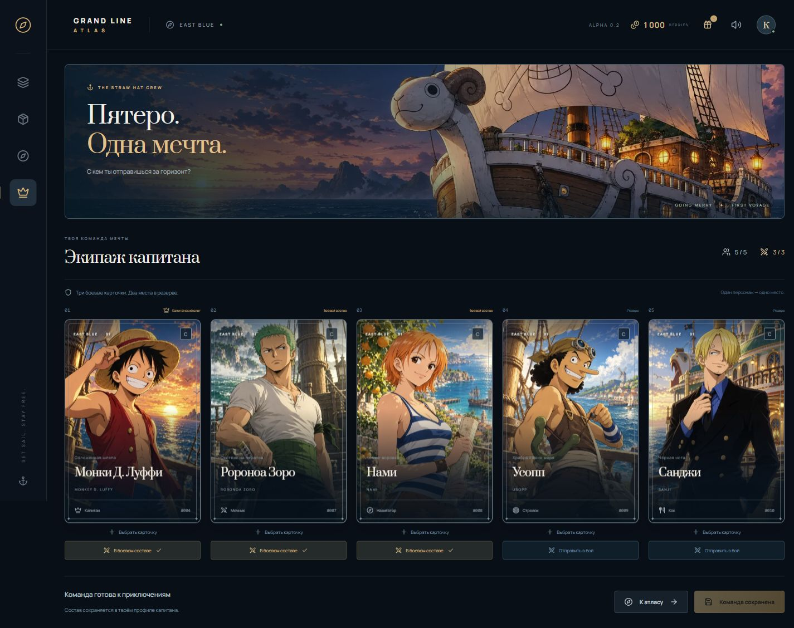

# Grand Line Atlas

Фанатский мир One Piece: коллекционные карточки, команда мечты и приключения на морском атласе.

## Локальная альфа 0.2

Первый рабочий цикл коллекционирования:

- Сохранённый профиль капитана, пять стартовых Мугивар и кошелёк Berries.
- Серверные случайные выпадения, подарочный бокс и покупка следующих за игровую валюту.
- Уникальные экземпляры карт, дубли, избранное, каталог и история открытий.
- Редактор экипажа: пять мест, три боевые карточки, смена изданий и перестановка персонажей.
- Ежедневный подарок с защитой от повторной выдачи.
- Подробный морской атлас: 176 мест, уровни детализации, поиск, иллюстрированные острова и движущиеся корабли Мугивар и Дозора.
- Полная сверка 107 маркеров OP Maps, отдельный слой фанатских позиций и 35 островов Тотто-Лэнда.
- Панорамы пяти локаций East Blue, морские маршруты и журнал капитана.
- Пять подготовленных портретов персонажей и кинематографичный экран «Гоинг Мерри».



## Запуск

Проверено на Node.js 24.19.0 и pnpm 11.25.0. Требуется Node.js 22+.

```sh
pnpm install --frozen-lockfile
pnpm dev
```

Открыть [коллекцию](http://127.0.0.1:3000), [боксы](http://127.0.0.1:3000/boxes), [команду](http://127.0.0.1:3000/crew) или [атлас](http://127.0.0.1:3000/world).

PostgreSQL запускается локально через PGlite. Docker и отдельная установка PostgreSQL не нужны. Данные автоматически создаются в .data/postgres и сохраняются между запусками. Один каталог базы используется одним серверным процессом.

Локальная сессия привязана к HttpOnly-cookie этого браузера; это ещё не облачный аккаунт. Supabase Auth, PvE, обмен, рынок и продажа дублей — следующие игровые этапы.

## Проверки

```sh
pnpm typecheck
pnpm test
pnpm build
```

Для HTTP-проверок нужен работающий сервер:

```sh
pnpm test:http
```

Тесты проверяют повторные и параллельные открытия, баланс, rollback, принадлежность карт, состав, ежедневный подарок, сессию, origin и сохранение после повторного открытия базы. Файловые тесты используют отдельный временный каталог и не меняют рабочий профиль.

## Стек

Next.js App Router, React, TypeScript, PostgreSQL/PGlite, Drizzle ORM, Zod, Motion, Lucide и собственные CSS-компоненты. Версии зафиксированы в pnpm-lock.yaml; сборочный скрипт esbuild явно разрешён в pnpm-workspace.yaml.

## Документация

- [MVP и архитектура](docs/PROJECT_BLUEPRINT.md)
- [Рабочее игровое ядро](docs/LOCAL_GAME_CORE.md)
- [Художественная доводка](docs/DESIGN_QUALITY.md)
- [Арты альфы и промпты](docs/ALPHA_ART.md)
- [Первый набор артов](docs/ART_DIRECTION.md)
- [Атлас](docs/ATLAS_DIRECTION.md)
- [Переработка атласа, источники и новые иллюстрации](docs/ATLAS_REBUILD.md)
- [Расширение по OP Maps и полная таблица покрытия](docs/OP_MAPS_COVERAGE.md)
- [Панорамы локаций и исходные промпты](docs/WORLD_PROTOTYPE.md)

Оптимизированные арты находятся в public/art и public/world; PNG-мастера — в assets/source-art и assets/source-world. Данные базы, локальные настройки и тестовые артефакты исключены из Git.
